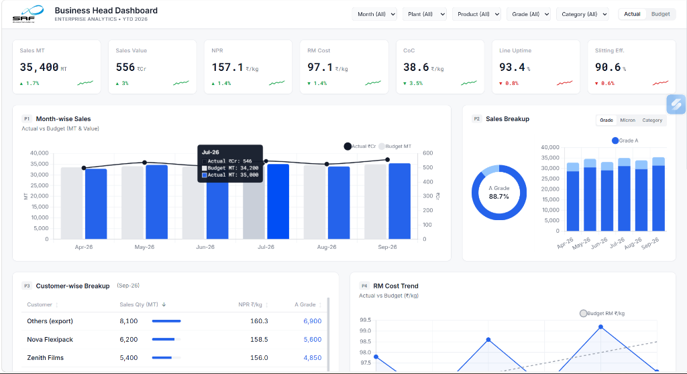
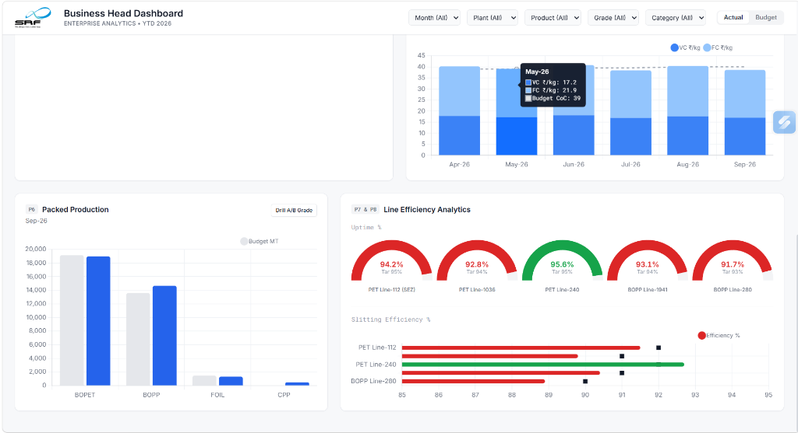

# SRF Business Head Dashboard

An enterprise analytics dashboard designed for SRF leadership to monitor sales performance, financial metrics, raw material costs, and plant production efficiency in real time.

---

## Dashboard Previews

### 1. Sales & Financial Overview


### 2. Production & Line Efficiency Analytics


---

## Key Highlights

- **Executive KPI Cards**: Real-time tracking of Sales MT, Sales Value (₹Cr), Net Price Realization (NPR), Raw Material Cost (RM Cost), Cost of Conversion (CoC), Line Uptime, and Slitting Efficiency with month-over-month variances.
- **Sales Analytics**: Month-wise Sales trends (MT vs Value), grade/micron/category breakup, and customer-wise volume distribution.
- **Cost & Production Tracking**: Variable Cost (VC) vs Fixed Cost (FC) trends, packed production across product lines (BOPET, BOPP, FOIL, CPP), and line efficiency gauges.
- **Interactive Multi-Filters**: Filter by Month, Plant, Product, Grade, and Category with Actual vs Budget toggle.

---

## Tech Stack

- **Frontend**: HTML5, React 18, Tailwind CSS
- **Visualizations**: Chart.js
- **Typography**: Inter & Roboto Mono

---

## Getting Started

Simply open `index.html` in any modern web browser, or serve it using a local static server:

```bash
# Using Python
python -m http.server 8000

# Using Node / npx
npx serve .
```
